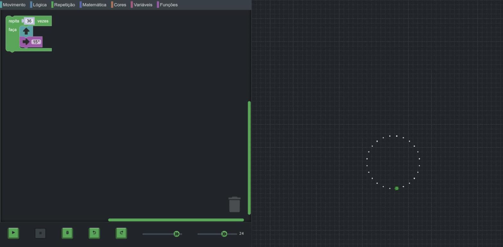

# Jabuti

A programming-logic learning game: snap Blockly blocks together and a turtle walks across a Phaser canvas, leaving a coloured trail.

[](https://github.com/whaletalent/jabuti/actions/workflows/ci.yml)
[](https://github.com/whaletalent/jabuti/actions/workflows/deploy.yml)

**▶ Play it: https://whaletalent.github.io/jabuti/**



## What it is

Jabuti ("tortoise" in Portuguese) is an educational, Logo-style game. Players build a program out of visual blocks (move, turn, repeat, set colour, use variables and functions) and press "Executar" to watch the turtle draw it. The workspace opens with a ready-made example (six times: cyan, five steps turning 15°, then pink, five steps turning 45°) that draws a two-colour flower; run it, change it or delete the blocks and start from scratch. It was made to introduce programming logic to Brazilian kids; the interface opens in English and switches to Portuguese (pt-BR) with the language button (the choice is remembered, and `?lang=pt` or `?lang=en` in the URL forces one). This README is in English. It works on desktops, tablets and phones: on narrow or portrait screens the canvas sits above the block editor.

## The blocks

The "Movimento" category holds the turtle blocks:

| Block   | What the turtle does                                   |
| ------- | ------------------------------------------------------ |
| `pf`    | Moves forward one step                                 |
| `pt`    | Moves back one step                                    |
| `pd`    | Turns right by a fixed angle (angle picker)            |
| `pe`    | Turns left by a fixed angle (angle picker)             |
| `pdv`   | Turns right by a value (accepts blocks and variables)  |
| `pev`   | Turns left by a value (accepts blocks and variables)   |
| `color` | Sets the trail colour (used from the "Cores" category) |

The rest of the toolbox is standard Blockly. The seven categories are Movimento, Lógica, Repetição, Matemática, Cores, Variáveis and Funções.

Controls (icon buttons, labels on hover): Run starts the program and is re-enabled when it ends, so successive runs accumulate on the canvas. Stop halts it, clears the trail and re-centres the turtle, and stays available after a run as a reset. Undo / Redo act on the blocks; drag blocks to the trash can in the editor to delete them. The language button switches between English and Portuguese. Two sliders set the speed (gauge icon; above the middle the run goes into a no-delay turbo) and the step length in pixels (ruler icon, 1 to 32, default 8).

## How it works

1. Blockly turns the block workspace into JavaScript, prefixing each statement with a `highlightBlock(id)` call.
2. JS-Interpreter runs that code in a sandbox, one interpreter step per tick (the delay between ticks is 55 minus the speed slider value, in ms; above 50 the delay is zero and several steps run per tick, up to 10 at the maximum).
3. The sandbox can only call a small API: `jabutiPF`, `jabutiPT`, `jabutiPD`, `jabutiPE`, `setColor` and `highlightBlock`.
4. Those calls update a plain turtle state (position, heading, colour, step) in `src/game/turtle.js`, which has no Phaser dependency and is unit-tested.
5. The Phaser scene moves the sprite and draws a line segment from the previous position to the new one onto a render texture.

## Tech stack

| Library                                                          | Why                                                                        |
| ---------------------------------------------------------------- | -------------------------------------------------------------------------- |
| [Vite 8](https://vite.dev)                                       | Dev server and build, with libraries installed from npm                    |
| [Blockly 13](https://developers.google.com/blockly)              | The visual block editor and the blocks-to-JavaScript generator             |
| `@blockly/field-angle`, `@blockly/field-colour`                  | Angle picker and colour blocks, which moved out of Blockly core            |
| [Phaser 4](https://phaser.io)                                    | The canvas: background, trail render texture and turtle sprite             |
| [Lucide](https://lucide.dev)                                     | Icon set for the control buttons and sliders                               |
| [JS-Interpreter 6](https://github.com/NeilFraser/JS-Interpreter) | Runs generated code step by step, so blocks can be highlighted and stopped |
| [Vitest](https://vitest.dev)                                     | Unit tests (the Vitest suite)                                              |
| ESLint, Prettier                                                 | Linting and formatting                                                     |
| GitHub Actions                                                   | CI, and deploy to GitHub Pages                                             |

It is plain JavaScript (ES modules): no framework and no TypeScript.

## Run locally

Requires Node 24 (see `.nvmrc`).

```bash
nvm use
npm ci
npm run dev
```

Then open <http://localhost:5173/jabuti/>. The app is served under `/jabuti/` because that is its path on GitHub Pages.

| Script                 | What it does                       |
| ---------------------- | ---------------------------------- |
| `npm run dev`          | Start the Vite dev server          |
| `npm run build`        | Production build into `dist/`      |
| `npm run preview`      | Serve the production build locally |
| `npm test`             | Run the unit tests once            |
| `npm run test:watch`   | Run the unit tests in watch mode   |
| `npm run lint`         | Lint with ESLint                   |
| `npm run lint:fix`     | Lint and apply automatic fixes     |
| `npm run format`       | Format with Prettier               |
| `npm run format:check` | Check formatting without writing   |

## Project structure

```
index.html            app shell: welcome dialog, toolbox, canvas mount, controls
vite.config.js        base path /jabuti/ and test setup
public/assets/        sprites (turtle, background, block icons)
public/fonts/         VCR OSD Mono, used by the welcome dialog
src/
  main.js             boot: language, icons, Blockly, Phaser, runner and UI wiring
  layout.js           stacked-vs-side-by-side media query and canvas sizing
  session.js          hands the program over a language switch (sessionStorage)
  runner.js           JS-Interpreter wrapper: run, step, stop, highlight
  ui.js               buttons, sliders, preloader, welcome dialog, language toggle
  i18n/               messages (pt, en), language detection, DOM translation
  blocks/             block definitions, generators, toolbox, Blockly setup
  game/               turtle.js (pure state), scene.js (Phaser), createGame.js
  styles/main.css
tests/                Vitest unit tests
docs/                 screenshot, design spec and implementation plan
.github/workflows/    ci.yml and deploy.yml
```

## CI & deploy

- **CI** (`ci.yml`) runs on every push and pull request: `npm ci`, lint, format check, tests and build.
- **Deploy** (`deploy.yml`) runs on pushes to `main`: it builds the app and publishes `dist/` to GitHub Pages.
- Dependabot keeps npm packages and GitHub Actions up to date.

## History

The original version was written in 2019 with an Express server, vendored Phaser 2.9 and Blockly, and a Heroku demo that is no longer online. It is preserved at the [`v1-legacy`](https://github.com/whaletalent/jabuti/tree/v1-legacy) tag. In 2026 it was rewritten on Vite, Blockly 13 and Phaser 4, keeping the same blocks and gameplay (design and plan are in `docs/superpowers/`).

## License

[MIT](LICENSE)
